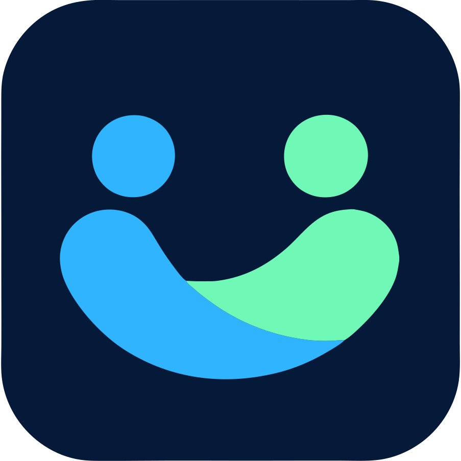
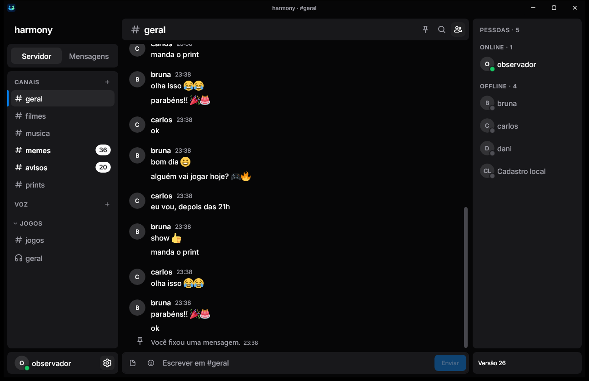
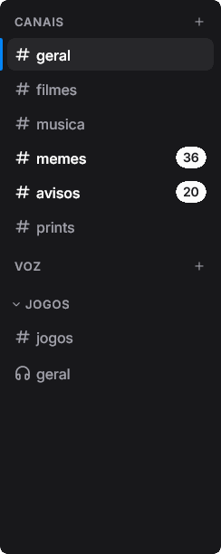
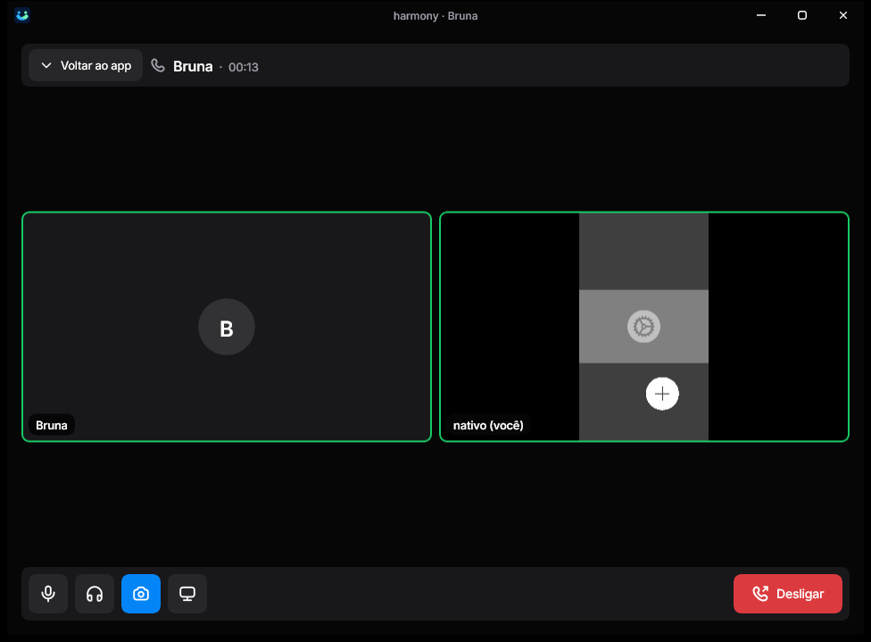
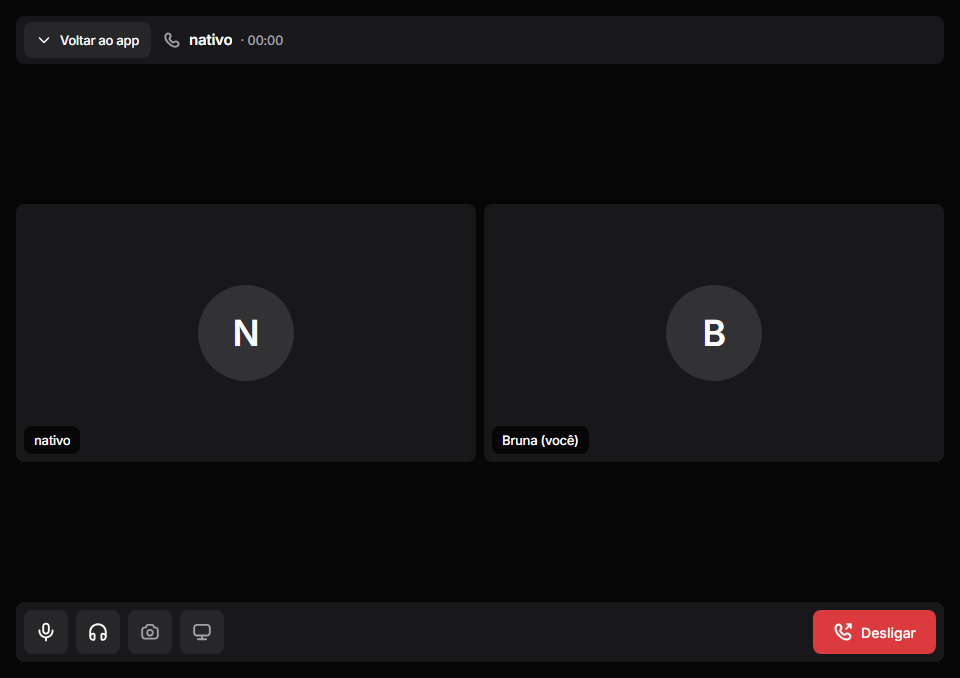
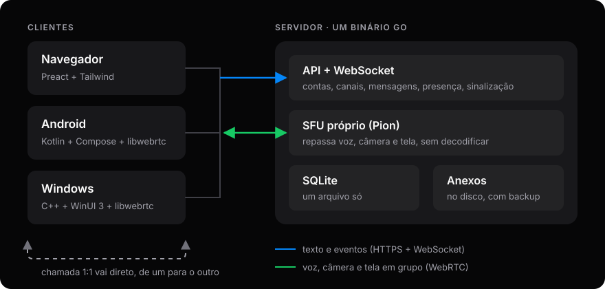

<p align="center">
  
</p>

<h1 align="center">harmony</h1>

<p align="center">Texto, voz e tela compartilhada para um grupo de cerca de 20 amigos, em um servidor só por convite.</p>

<p align="center"><sub><i>A small, self-hosted, invite-only Discord-like service for a group of friends: text channels, group voice with screen sharing through its own Go/Pion SFU, direct messages and 1:1 calls, with a web client and native Android (Kotlin) and Windows (C++/WinUI 3) apps. Documentation is in Portuguese.</i></sub></p>

<p align="center">
  
  
  
  
</p>

<p align="center">
  
</p>

<table>
  <tr>
    <td align="center" width="20%"><a href="docs/imagens/windows-canais.png"></a></td>
    <td align="center" width="40%"><a href="docs/imagens/windows-chamada.png"></a></td>
    <td align="center" width="40%"><a href="docs/imagens/web-chamada.png"></a></td>
  </tr>
  <tr>
    <td align="center">Canais e categorias</td>
    <td align="center">Chamada no Windows</td>
    <td align="center">Chamada no navegador</td>
  </tr>
</table>

<p align="center"><sub>Capturas com contas e mídia sintéticas de teste. Clique para ampliar.</sub></p>

## O que ele faz

- Canais de texto com histórico, imagens, reações, menções e mensagens fixadas.
- Canais de voz para conversar em grupo, com câmera, mudo e volume por pessoa.
- Compartilhamento de tela com áudio para jogos e filmes, com opções de até 1080p60, conforme o cliente e o equipamento.
- Mensagens diretas e chamadas 1:1 com voz, câmera e tela.
- Presença, mensagens não lidas e notificações de menções e conversas diretas.
- Acesso pelo navegador e por aplicativos nativos para Android e Windows.

## Como é feito

O servidor é um binário Go com API HTTP, gateway WebSocket e SFU próprio com Pion. O cliente web é compilado e incluído nesse mesmo binário. Contas, canais e mensagens ficam no SQLite; os arquivos enviados ficam no disco.

<p align="center"></p>

O SFU faz parte do processo Go. As setas dos clientes representam o acesso ao serviço; a mídia dos canais usa WebRTC com o SFU. Chamadas diretas 1:1 usam uma conexão entre os participantes, com TURN como alternativa quando a rede exige.

## Decisões do projeto

| Decisão | Motivo e consequência |
|---|---|
| **SFU próprio que nunca decodifica** | Encaminha a mídia comprimida aos participantes, sem decodificar ou transcodificar no servidor. |
| **Só por convite** | Cada convite é de uso único. O dono controla quem entra; o serviço foi pensado para um grupo pequeno. |
| **SQLite** | Um arquivo de banco, com driver puro Go e sem cgo. Dispensa um serviço separado de banco de dados. |
| **H.264 para compartilhar a tela** | A escolha veio de medições de custo de CPU, com jogos, filmes e fluidez como prioridade. |
| **Aplicativos nativos, sem Electron** | Android usa Kotlin e Compose; Windows usa C++ e WinUI 3. Ambos usam libwebrtc para áudio e vídeo. |

## Pastas principais

```text
cmd/harmony/          Entrada do servidor e comandos de manutenção
internal/harmony/    API, WebSocket, SFU, banco, contas e notificações
web/harmony/         Cliente web em Preact e Tailwind
android/             Aplicativo Android em Kotlin e Compose
windows/             Aplicativo Windows e componentes nativos
e2e-harmony/         Testes do harmony no navegador
tools/               Ícone e ferramentas de apoio
docs/                Protocolos e imagens
scripts/             Ferramentas de teste e medição
deploy/harmony/      Backup cifrado, ensaio de restauração e vigia (systemd)
deploy/coturn/       Configuração do retransmissor das chamadas diretas
```

O guia do aplicativo Windows está em [windows/app/LEIAME.md](windows/app/LEIAME.md).

O retransmissor (TURN) usado nas chamadas diretas fica em [deploy/coturn/](deploy/coturn/LEIAME.md).

## Rodar localmente

Pré-requisitos: **Go 1.26 ou superior**, **Node.js compatível com Vite 8** e npm, com as dependências de `web/package.json` já disponíveis. Execute os comandos na raiz do repositório. Não é necessário Docker para este fluxo.

Primeiro, compile o cliente web:

```sh
npm --prefix web run build:harmony
```

Depois, em um terminal **PowerShell**, crie uma pasta de dados de desenvolvimento e gere o primeiro convite:

```powershell
New-Item -ItemType Directory -Force data/local | Out-Null
$env:HARMONY_BASE_URL = 'http://localhost:8080'
$env:HARMONY_INSECURE_COOKIE = '1'
go run ./cmd/harmony -db ./data/local/harmony.db -invite
```

O comando imprime um link de uso único. Guarde-o para abrir depois de iniciar o servidor, no mesmo terminal:

```powershell
go run ./cmd/harmony -addr localhost:8080 -db ./data/local/harmony.db -files ./data/local/files -app ./data/local/app -diagnostics ./data/local/diagnostics -voice-port 0
```

Abra o link gerado para criar a conta. O Go serve o web e a API em `http://localhost:8080`. Esse exemplo usa um banco local separado e desliga a voz; permite experimentar cadastro, canais e mensagens sem configurar a rede de mídia. A opção de cookie sem HTTPS serve apenas para desenvolvimento local. Sem um provedor de envio configurado, os fluxos de confirmação de conta e recuperação de senha ficam indisponíveis.

Para habilitar voz, câmera e tela em grupo, o servidor também precisa da configuração de WebRTC e de uma porta UDP acessível aos clientes. As variáveis estão em [.env.harmony.example](.env.harmony.example), e a forma de rodar em produção em [docker-compose.harmony.yml](docker-compose.harmony.yml), [harmony.Dockerfile](harmony.Dockerfile) e [Caddyfile.harmony](Caddyfile.harmony). O exemplo acima não configura essas peças.

Os aplicativos Android e Windows vêm apontados para a instância do autor; para usar a sua, troque o endereço do servidor nos ajustes de cada um (ou no código, ao compilar).

Depois de alterar o cliente web, repita `build:harmony` e reinicie o Go para incorporar o novo bundle. Para trabalhar com Vite, o script existente é `npm --prefix web run dev:harmony`; a configuração de base e dos proxies fica em [web/harmony/vite.config.ts](web/harmony/vite.config.ts).

Verificações do projeto:

```sh
go vet ./...
bash scripts/go-test.sh
npm --prefix web run typecheck
```

No Windows, use Git Bash para o script de testes Go. Ele mantém os executáveis de teste em caminhos fixos para evitar novas perguntas do firewall a cada execução.

## Documentação

- [Protocolo do harmony](docs/PROTOCOL-HARMONY.md): comunicação dos clientes com o serviço.
- [Protocolo de chamada direta](docs/PROTOCOL.md): sinalização 1:1.
- [Aplicativo Windows](windows/app/LEIAME.md).

## Licença

[GNU Affero General Public License v3.0](LICENSE). Quem rodar uma versão modificada como serviço precisa oferecer o código dessa versão aos usuários dela.

Componentes de terceiros mantêm as próprias licenças: a lista e os textos estão em [THIRD-PARTY.md](THIRD-PARTY.md) e [licencas/](licencas/) (fonte Inter, Twemoji, ícones do Gravity UI, libwebrtc, NVIDIA Video Codec SDK, DeepFilterNet).
